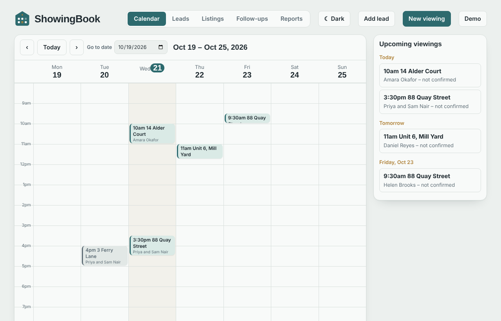
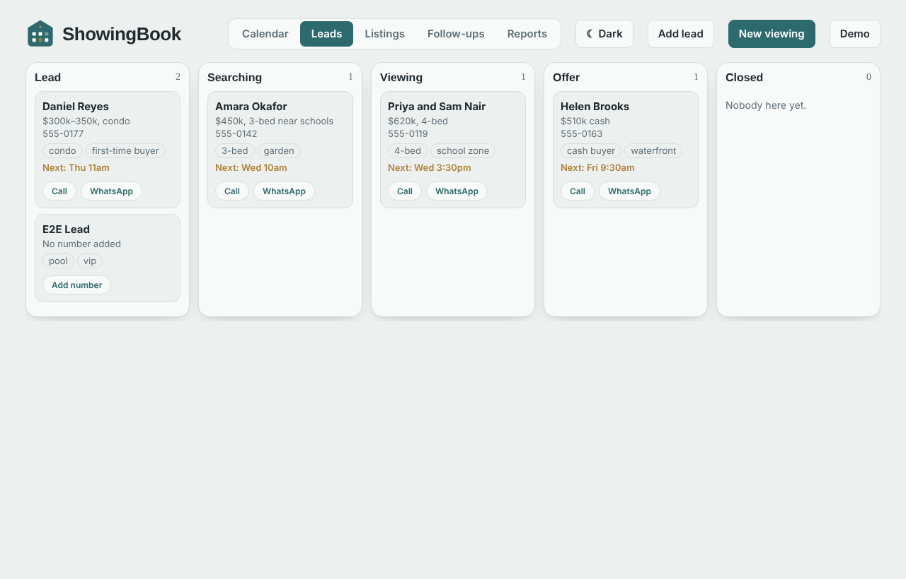
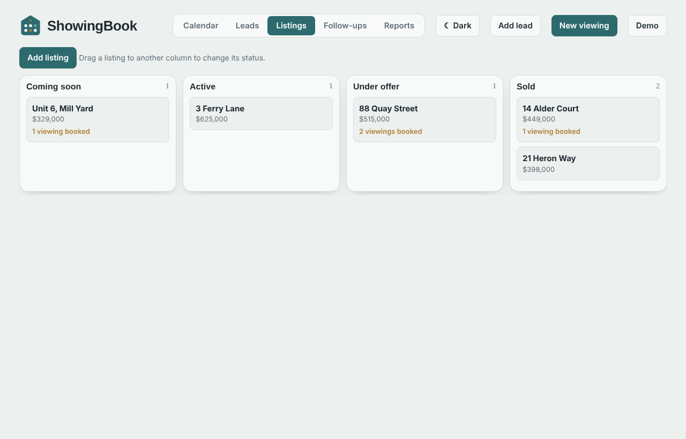
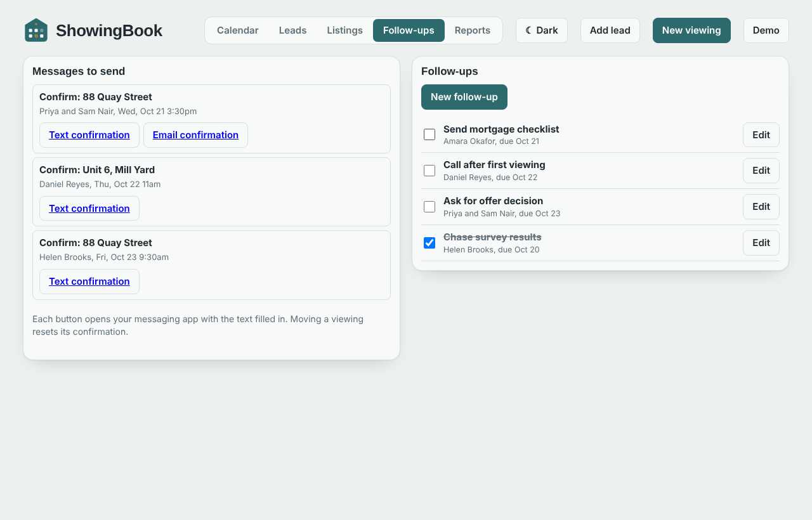
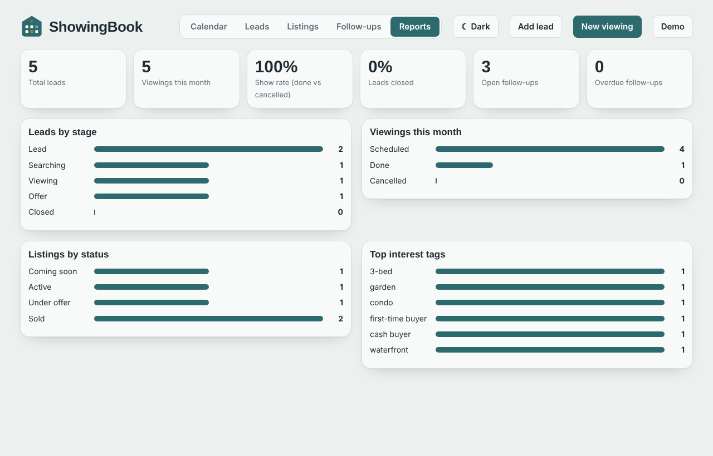
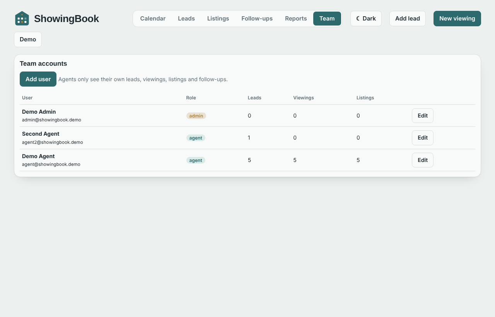
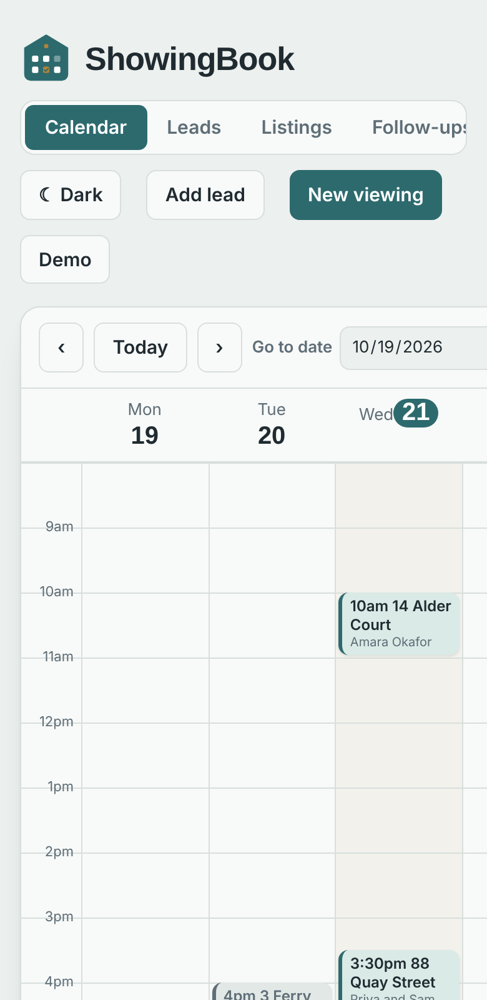

# ShowingBook

A CRM and viewing calendar for independent real estate agents. Agents sign in, keep their leads, showings, listings and follow-ups in one place, and send confirmation and reminder messages with one tap.



## Who it is for
Independent agents and small teams. Each agent only ever sees their own records; an **admin** manages the team's accounts.

## Features
- **Viewing calendar** – week view, drag-and-drop to reschedule, click an empty slot to book, overlap warning.
- **Leads** – five-stage board (Lead → Closed), interest tags, call / WhatsApp / social links.
- **Confirmation and reminder messages** – opens the phone's SMS or email app with the text filled in (nothing is sent automatically, so no SMS provider or API keys are needed).
- **Listing pipeline** – Coming soon / Active / Under offer / Sold, drag a card to change status.
- **Follow-up tasks** – due dates, overdue highlighting, linked to leads.
- **Reports** – leads by stage, viewings this month, show rate, listings by status, top interest tags.
- **Accounts and roles** – sign-in, `admin` and `agent` roles, admin Team screen, change password.
- **PWA** – installable from the browser, light and dark theme.
- **Capacitor-ready** – wrap the same web app as an Android / iOS app.

| Leads | Listings |
|---|---|
|  |  |

| Follow-ups | Reports |
|---|---|
|  |  |

| Admin team screen | Mobile |
|---|---|
|  |  |

## Tech stack
- Front end: vanilla JavaScript (ES modules), no framework, no build step.
- Back end: Node.js 22.13+ and Express, SQLite (Node built-in `node:sqlite`, no native add-ons), JWT sign-in, bcrypt password hashes.
- Mobile: Capacitor 7 configuration included.

## Quick start
```bash
cp .env.example .env          # then edit it (see HowToSetup.md)
cd Project
npm ci
npm run db:reset              # creates the database and loads demo data (development only)
npm start                     # http://localhost:3000
```
Demo accounts (from `database/seed.sql`, development only): `admin@showingbook.demo` and `agent@showingbook.demo`, password `Demo#Pass2026`.

Full install steps for a VPS and for Docker, first admin login, branding and the Android/iOS apps: **[HowToSetup.md](HowToSetup.md)**.

## Repository layout
```
README.md  HowToSetup.md  CLAUDE.md  CHANGELOG.md  LICENSE-NOTE.md
.env.example  docker-compose.yml
Project/            the application (server, web app, Capacitor config)
database/           schema.sql and seed.sql
docs/               API reference and screenshots
```

## Tests
`cd Project && npm test` runs 15 API tests (authentication, roles, record isolation between users, validation, SQL-injection handling).

## Licence
See [LICENSE-NOTE.md](LICENSE-NOTE.md).
